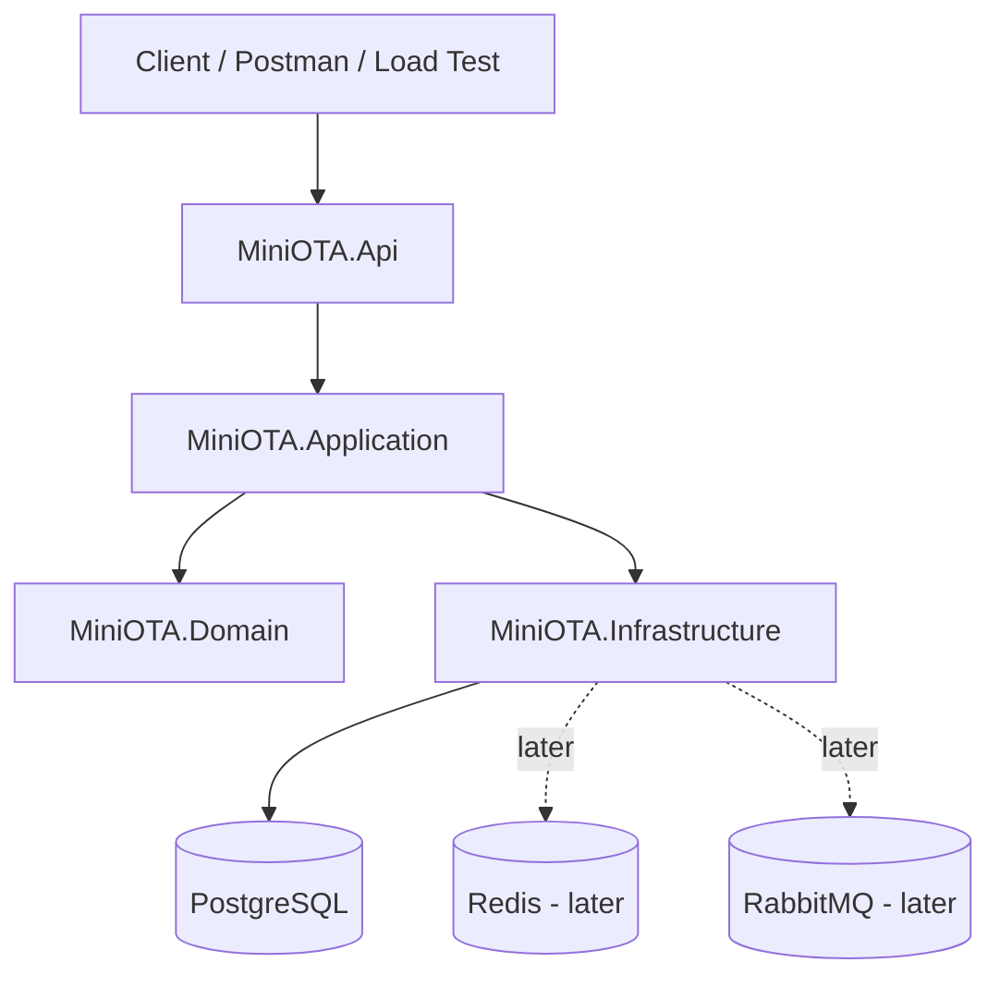
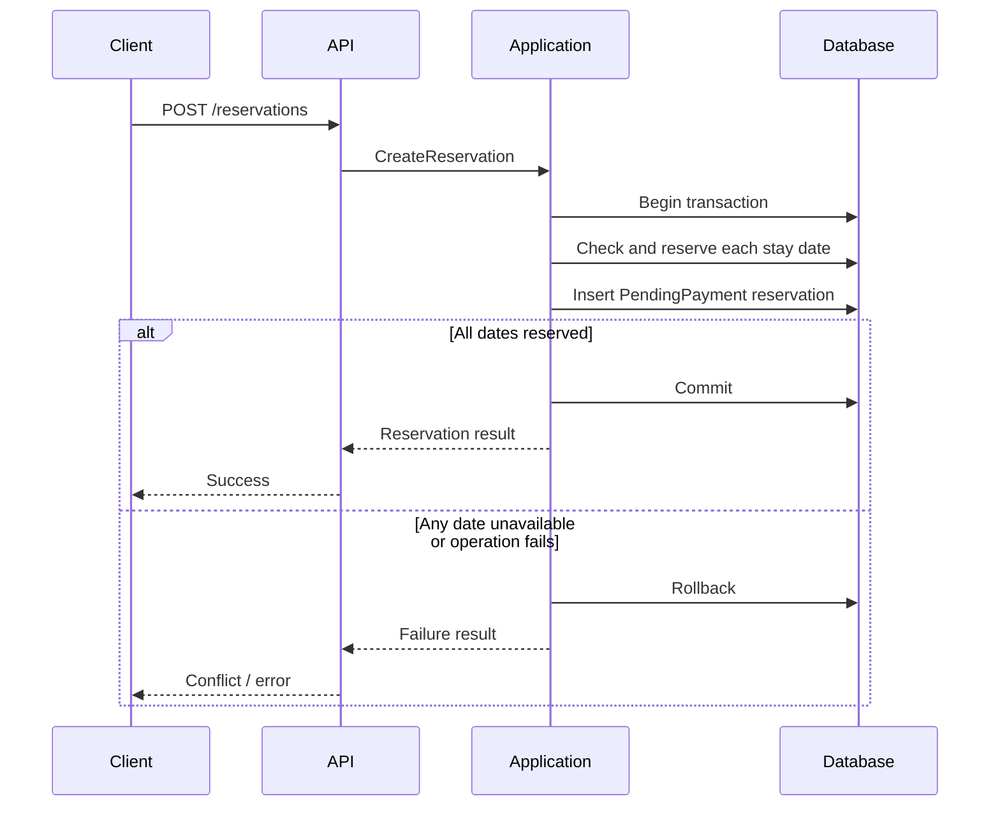

# System Architecture — Mini OTA Booking System

- **Version:** 0.1
- **Architecture style:** Layered Architecture
- **Deployment style:** Single ASP.NET Core application for the first release

## 1. Architecture goals

The first version should be easy to understand, test, and operate while providing a sound foundation for concurrency experiments.

Priorities:
- Clear separation of responsibilities
- Domain rules independent of infrastructure
- Transactional inventory updates
- Testable application workflows
- Incremental adoption of Redis and RabbitMQ

Microservices are intentionally not part of the initial design. A modular monolith is sufficient for this learning scope.

## 2. High-level component view



## 3. Layer responsibilities

### 3.1 MiniOTA.Api

Responsibilities:
- Expose HTTP endpoints
- Validate request shape and basic input constraints
- Translate application results into HTTP responses
- Configure dependency injection and middleware
- Expose OpenAPI / Swagger in development

Must not:
- Contain inventory business rules
- Directly manipulate EF Core entities for booking workflows
- Implement transaction orchestration inside controllers

### 3.2 MiniOTA.Application

Responsibilities:
- Coordinate use cases such as querying availability and creating reservations
- Define application commands, queries, and result types
- Coordinate transaction boundaries through abstractions
- Enforce use-case sequencing
- Define interfaces needed from infrastructure

Example use cases:
- `QueryAvailability`
- `CreateReservation`
- `GetReservation`
- `PayReservation`
- `CancelReservation`
- `ExpireReservations`

### 3.3 MiniOTA.Domain

Responsibilities:
- Define core domain concepts and rules
- Represent reservation status and valid state transitions
- Define inventory invariants
- Avoid dependencies on ASP.NET Core, EF Core, PostgreSQL, Redis, and RabbitMQ

Potential domain concepts:
- `Reservation`
- `ReservationStatus`
- `DailyInventory`
- `StayDateRange`

### 3.4 MiniOTA.Infrastructure

Responsibilities:
- Implement persistence using EF Core and PostgreSQL
- Implement repository or persistence abstractions where useful
- Configure database mappings and migrations
- Implement transaction and concurrency-control mechanics
- Later integrate Redis and RabbitMQ

Infrastructure-specific SQL or locking behavior belongs here, behind application-facing abstractions where practical.

## 4. Initial project structure

```text
MiniOTA/
├── src/
│   ├── MiniOTA.Api/
│   ├── MiniOTA.Application/
│   ├── MiniOTA.Domain/
│   └── MiniOTA.Infrastructure/
├── tests/
│   ├── MiniOTA.UnitTests/
│   └── MiniOTA.IntegrationTests/
├── MiniOTA_Docs/
│   ├── README.md
│   └── docs/
├── docker/
│   └── docker-compose.yml
└── MiniOTA.sln
```

## 5. Dependency direction

Expected compile-time dependencies:

```text
MiniOTA.Api ------------> MiniOTA.Application
       |                           |
       +----> MiniOTA.Infrastructure
                                   |
MiniOTA.Infrastructure ----------> MiniOTA.Application
MiniOTA.Application --------------> MiniOTA.Domain
MiniOTA.Infrastructure ----------> MiniOTA.Domain
```

The Domain project should have no dependency on the other application projects.

The API composition root may reference Infrastructure to register implementations in dependency injection. Application code should depend on abstractions, not concrete database implementations.

## 6. Initial booking flow



The implementation must ensure that the inventory operation is concurrency-safe. A simple read-then-write sequence without a database-enforced guard is not sufficient.

## 7. Reservation payment and expiration

Payment, cancellation, and expiration must:
1. Start a database transaction.
2. Perform a guarded state transition from the expected current state.
3. Change the relevant daily inventory rows.
4. Commit only if all required changes succeed.

The first version may run expiration through an ASP.NET Core `BackgroundService`. The worker must be safe to retry and must not assume that it will always finish before process shutdown.

## 8. Data ownership and transaction boundary

PostgreSQL is the source of truth for reservation state and inventory.

For the first release:
- Reservation state and daily inventory are stored in the same database.
- A single reservation operation uses one database transaction.
- Redis is not the source of truth for room inventory.
- RabbitMQ is not required for the first synchronous booking workflow.

If later workflows publish messages after a database commit, evaluate the Outbox Pattern to avoid a database/message-broker dual-write gap.

## 9. Testing strategy

- Domain unit tests: state transitions and invariants
- Application tests: use-case behavior
- Integration tests: PostgreSQL transactions, constraints, and concurrency
- Load tests: k6 scenarios with controlled inventory and concurrent clients

Concurrency correctness must be verified against PostgreSQL, not only mocked repositories or in-memory providers.

## 10. Future evolution

| Phase | Addition | Reason |
|---|---|---|
| Baseline | ASP.NET Core + PostgreSQL | Correct booking behavior |
| Concurrency | Conditional updates / row locks / optimistic concurrency | Prevent overselling |
| Reliability | Idempotency and expiration worker | Safe retries and recovery |
| Distributed processing | RabbitMQ + Outbox | Reliable asynchronous events |
| Coordination/cache | Redis | Selected cache or coordination experiments |
| Observability | OpenTelemetry | Trace latency and failures |
| Performance | k6 | Measure throughput and bottlenecks |

## 11. Architecture constraints

- Do not introduce microservices before there is a demonstrated need.
- Do not use Redis locks as a substitute for database integrity.
- Do not claim exactly-once message delivery; design idempotent effects.
- Do not mix real external payment side effects into a database transaction.
- Record material architecture changes as ADRs.
